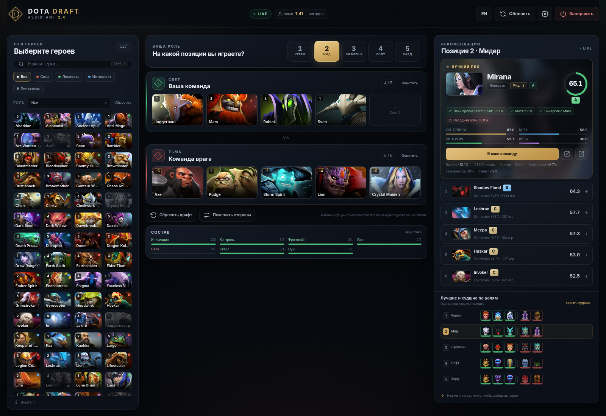

# Dota Draft Assistant 2.0

[](https://github.com/wthxtzy/Dotabuff-guides-and-counters/actions/workflows/build.yml)

Локальный помощник по драфту Dota 2, который работает в браузере на `127.0.0.1`.
Перетаскивайте героев в свою команду и в команду врага — приложение в реальном
времени подбирает, кого взять на вашу позицию и какие варианты лучше/хуже
подходят для остальных ролей.



## Что нового по сравнению с первой версией

Старая версия была консольной C++ программой для Windows: она спрашивала имя
героя и открывала страницу Dotabuff в браузере. Версия 2.0 — это отдельное
локальное веб-приложение:

- один Go-бинарник без Python/Node/Electron в рантайме;
- Windows и Linux, включая arm64;
- запускается в фоне и не занимает терминал;
- кнопка **Завершить / Terminate** останавливает локальный сервер;
- drag & drop героев в слоты своей и вражеской команды;
- выбор позиции 1–5 и рекомендации отдельно под вашу роль;
- блок «лучшие/худшие по ролям» для остальных позиций;
- кнопка **Сбросить драфт** для следующей игры;
- русский и английский интерфейс;
- обновление данных из OpenDota прямо из интерфейса;
- офлайн-снимок данных и иконок уже внутри бинарника.

## Быстрый старт

### Windows

1. Соберите проект (см. ниже) или возьмите готовый `dist/windows-amd64/DotaDraftAssistant.exe`.
2. Запустите `DotaDraftAssistant.exe` двойным кликом.
3. Браузер откроется сам: `http://127.0.0.1:27890/`.

Консольного окна нет: бинарник собран с `-H=windowsgui`. Кнопка **Завершить**
в правом верхнем углу выключает сервер. SmartScreen может предупредить, потому
что бинарник не подписан — «Подробнее» → «Выполнить в любом случае».

### Linux

```bash
tar -xzf dota-draft-linux-amd64.tar.gz
cd linux-amd64
./start.sh
```

`start.sh` запускает сервер через `nohup` и сразу возвращает терминал. Браузер
открывается автоматически. Чтобы добавить приложение в меню:

```bash
./install-desktop.sh
```

Если браузер не открылся, URL лежит в
`~/.config/DotaDraft/session.json`. По умолчанию это
`http://127.0.0.1:27890/`. Остановка — кнопкой **Завершить**.

### Запуск из исходников

```bash
go run .
```

Для запуска без автоматического открытия браузера:

```bash
go run . -no-browser -port 27890
```

`go run` занимает терминал. Для фонового запуска используйте собранный бинарник
и `start.sh` (Linux) или GUI-бинарник (Windows).

## Как пользоваться

1. **Выберите позицию** — 1 (керри), 2 (мид), 3 (оффлейн), 4 (софт-саппорт)
   или 5 (хард-саппорт).
2. **Добавьте врагов** — перетащите иконки в красную команду. Можно нажать на
   героя в пуле и выбрать «В команду врага».
3. **Добавьте союзников** — то же самое для зелёной команды.
4. Смотрите рекомендации справа. Они пересчитываются после каждого добавления.
5. **Сбросить драфт** очищает обе команды, но сохраняет выбранную роль.
6. **Поменять стороны** меняет команды местами, если вы ошиблись стороной.
7. **Завершить** останавливает локальный сервер. Драфт остаётся в
   `localStorage` браузера и восстановится при следующем запуске.

Дополнительно:

- поиск по имени и фильтры по атрибуту/роли;
- клик по карточке в рекомендациях добавляет героя в свою команду;
- на пустых слотах есть подсказка, а на слотах врага — оценка позиции (`~3`);
- `Ctrl/Cmd + K` фокусирует поиск, `Esc` закрывает меню и модальные окна;
- настройки: язык, стиль рекомендаций, обновление данных и источники.

## Как считаются рекомендации

Для каждого героя-кандидата считается четыре компонента (0–100), затем они
смешиваются с весами выбранного стиля.

| Компонент | Что учитывает |
|---|---|
| **Контрпики** | винрейт кандидата против каждого врага; отдельно — против предполагаемого лейн-оппонента; штраф за худший матчап |
| **Мета** | винрейт героя в Ancient+Divine (или по всем рангам, если выборка мала) |
| **Синергия** | закрытие потребностей состава: инициация, контроль, фронтлайн, урон, сейв, скейл, пуш; плюс парные бонусы с союзниками |
| **Роль** | насколько герой исторически играется на выбранной позиции |

Стили рекомендаций:

- **Баланс** — 42% контрпики, 20% мета, 23% синергия, 15% роль;
- **Контрпики** — 60/12/13/15;
- **Мета** — 18/50/17/15;
- **Комфорт** — 32/23/15/30.

Если врагов ещё нет, вес контрпиков обнуляется и перераспределяется. Если нет
союзников, синергия считается нейтральной.

### Контрпики и шум выборки

OpenDota отдаёт не «истинный» контрпик, а наблюдения по недавним публичным
матчам. Для пары героев выборка может быть небольшой (десятки игр), поэтому
используется сглаживание:

- ожидаемый винрейт пары оценивается по силе обоих героев;
- наблюдение сжимается к ожиданию с байесовским приором;
- в интерфейсе показываются число матчей и «уверенность»;
- маленькая выборка не игнорируется полностью, но не должна выглядеть как
  абсолютная истина.

### Роли и лейн-оппоненты

OpenDota не публикует винрейты по позициям 1–5. Карта гибкости героев лежит в
[`data/positions.json`](data/positions.json) и является курируемой эвристикой
(её можно править и пересобирать бинарник). По ней:

- кандидаты фильтруются, чтобы в рекомендациях на позицию 1 не появлялись
  хард-саппорты;
- для врагов жадно подбираются наиболее вероятные позиции;
- если уверенность низкая, на слоте показывается `?`, а лейн-бонус не
  применяется.

Это не замена статистике ролей со Stratz, но честный компромисс при работе
без API-ключей.

## Данные и источники

Основной источник — **OpenDota** (публичные разобранные матчи):

- `GET /api/heroStats` — винрейты и пики/баны (включая pro-поля);
- `GET /api/heroes/{id}/matchups` — матрица матчапов;
- официальная атрибутика героев и ссылки на портреты Valve/Steam CDN.

**Dotabuff** и **Stratz** не предоставляют открытый API, который можно было бы
бесплатно и стабильно использовать в локальном приложении. Dotabuff закрыт
Cloudflare, Stratz требует токен. Поэтому в 2.0 они присутствуют как ссылки на
гайды/контрпики и страницы героев, а не как источник автоматических данных.
Приложение ничего не скрейпит и не обходит защиты.

Снимок данных, вшитый в бинарник, собран **2 ноября 2026** для патча **7.41**:
127 героев и 15 966 строк матчапов. Свежесть видна в шапке; если данным больше
недели, появится напоминание об обновлении.

Обновление: **Настройки → Обновить из OpenDota**. Приложение последовательно
загружает 127 наборов матчапов (примерно 2–4 минуты, лимит OpenDota ~60
запросов/мин), показывает прогресс и сохраняет кэш в каталог пользователя:

- Windows: `%AppData%\DotaDraft\data\`;
- Linux: `~/.config/DotaDraft/data/`.

Если обновление не удалось, продолжает использоваться старый снимок.

## Сборка

Нужен Go 1.22+ (проверено на Go 1.27). Внешних Go-зависимостей нет.

```bash
./build.sh
```

или в Windows:

```powershell
powershell -ExecutionPolicy Bypass -File build.ps1
```

Будут собраны:

```
dist/linux-amd64/dota-draft
dist/linux-arm64/dota-draft
dist/windows-amd64/DotaDraftAssistant.exe
dist/windows-arm64/DotaDraftAssistant.exe
dist/*.tar.gz, dist/*.zip, dist/SHA256SUMS.txt
```

Windows-бинарники собираются с `-H=windowsgui`: при двойном клике консоль не
появляется. Linux-бинарники статические (`CGO_ENABLED=0`).

### Пересборка снимка данных

Нужен Python 3 и Pillow:

```bash
pip install pillow
python3 tools/build_seed.py --all
```

Скрипт скачает актуальные `heroStats`, матрицу матчапов и иконки, затем
пересоберёт [`data/heroes.json`](data/heroes.json),
[`data/matchups.json`](data/matchups.json) и [`data/meta.json`](data/meta.json).
Позиции героев он не трогает — это ручная карта
[`data/positions.json`](data/positions.json).

## Структура проекта

```
main.go            запуск, порт, singleton, браузер, сигналы
server.go          HTTP API, статика, безопасность, shutdown
dataset.go         загрузка/кэш снимка, матрица матчапов
recommend.go       движок рекомендаций
refresh.go         обновление данных из OpenDota
model.go           модели героев и меты
positions.go       эвристика ролей и сейв-героев
assets.go          embed веб-интерфейса и данных
web/               index.html, app.js, style.css, иконки
data/              снимок данных и карта позиций
tools/build_seed.py
legacy/            старый C++ прототип
```

API:

- `GET /api/health` — проверка запущенного экземпляра;
- `GET /api/state` — герои, мета, источники, статус обновления;
- `POST /api/recommend` — рекомендации по драфту;
- `POST /api/refresh` / `GET /api/refresh` — запуск и прогресс обновления;
- `POST /api/shutdown` — корректная остановка сервера.

## Безопасность и приватность

- сервер слушает только `127.0.0.1` (недоступен из локальной сети);
- проверяются `Host` и `Origin` (защита от DNS rebinding и CSRF);
- изменяющие запросы требуют заголовок `X-Dota-Draft: 1`;
- включены CSP, `X-Frame-Options: DENY`, `nosniff`;
- драфт хранится только в `localStorage` браузера;
- телеметрии нет; при обновлении данных выполняются только запросы к
  `api.opendota.com` и `cdn.cloudflare.steamstatic.com` (при наличии кэша
  иконок — только к OpenDota).

Порт по умолчанию — `27890`. Если он занят, приложение пробует следующие
порты; URL всегда пишется в `session.json` и открывается в браузере.

## Ограничения

- только 5 героев на команду, без банов и без фаз пиков;
- роли и лейн-оппоненты — эвристика, а не официальная статистика позиций;
- синергия — эвристика по ролям и потребностям состава, а не ко-пик-статистика;
- Dotabuff и Stratz не используются как источники данных (только ссылки);
- выборки матчапов могут быть небольшими; смотрите на «уверенность» и число игр;
- рекомендации — поддержка решения, а не гарантия победы.

## Старая версия

Исходники C++ консольного прототипа и `.sln` сохранены в
[`legacy/`](legacy/). Готовые `.exe`/`.dll` из старого дерева удалены, потому
что они остаются в истории git и не нужны версии 2.0.

## Лицензия

Проект не задаёт лицензию. Данные OpenDota и изображения героев принадлежат их
правообладателям; приложение использует публичные API и CDN.
